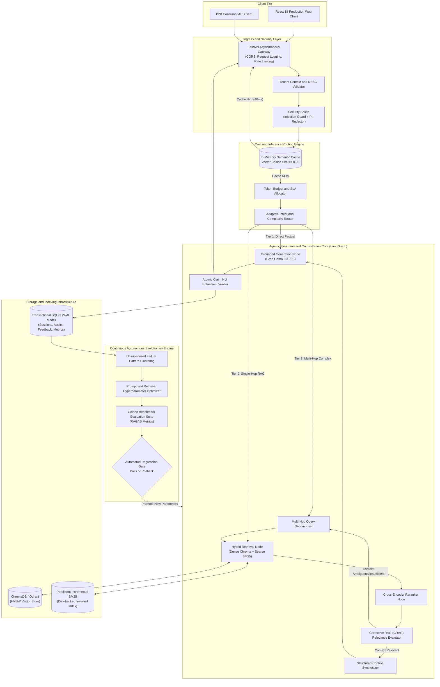
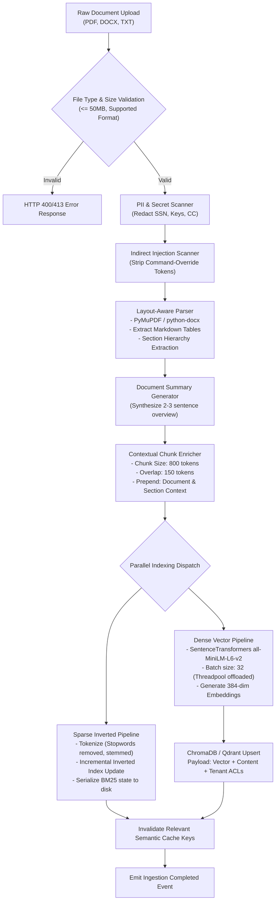
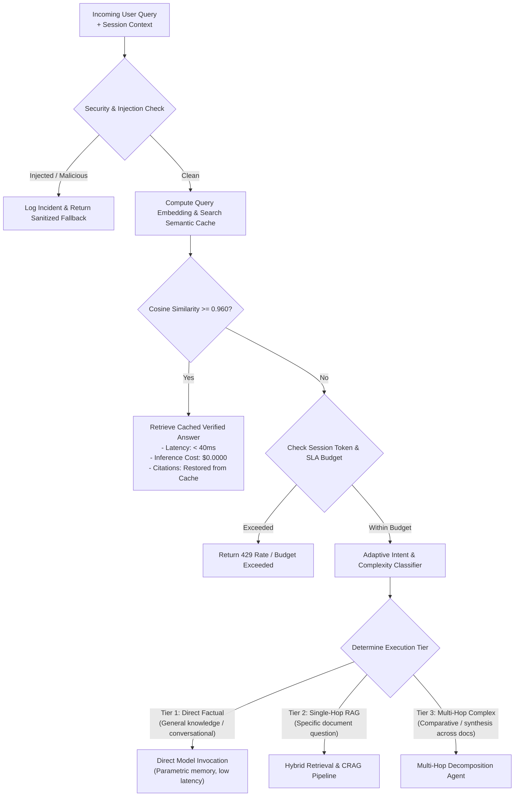
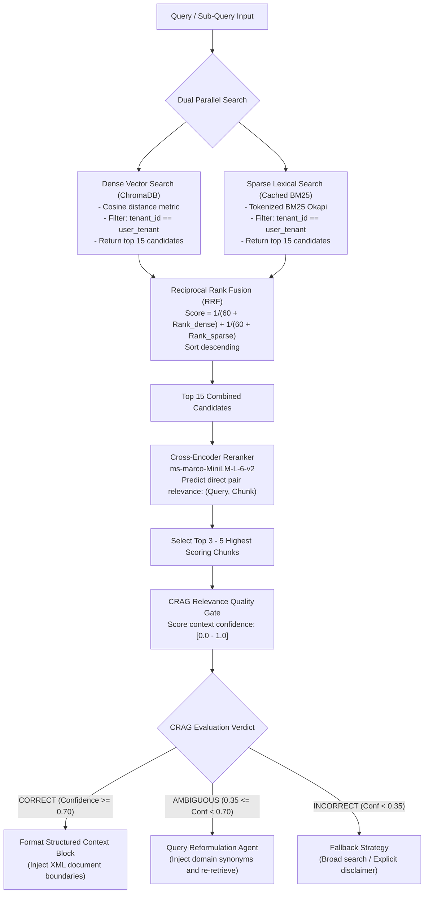
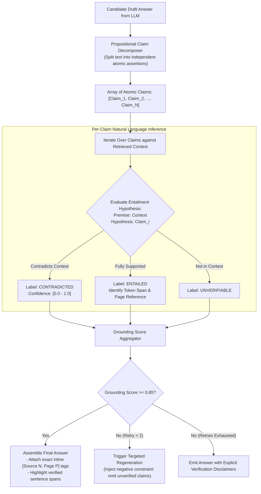
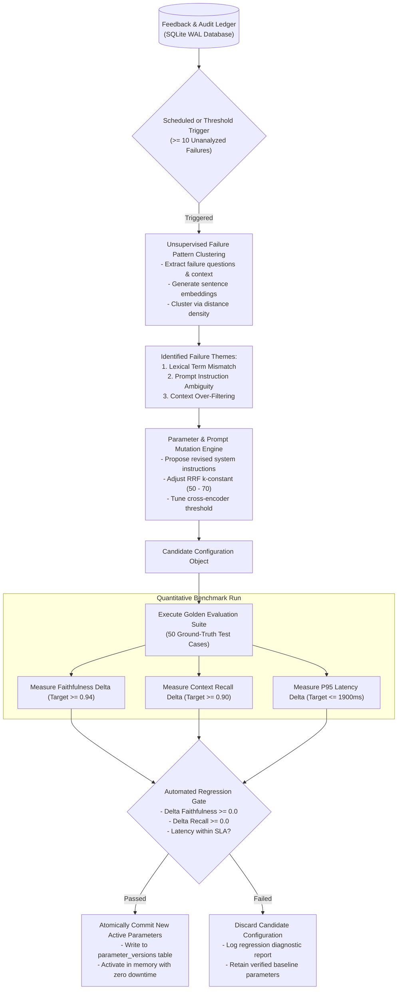
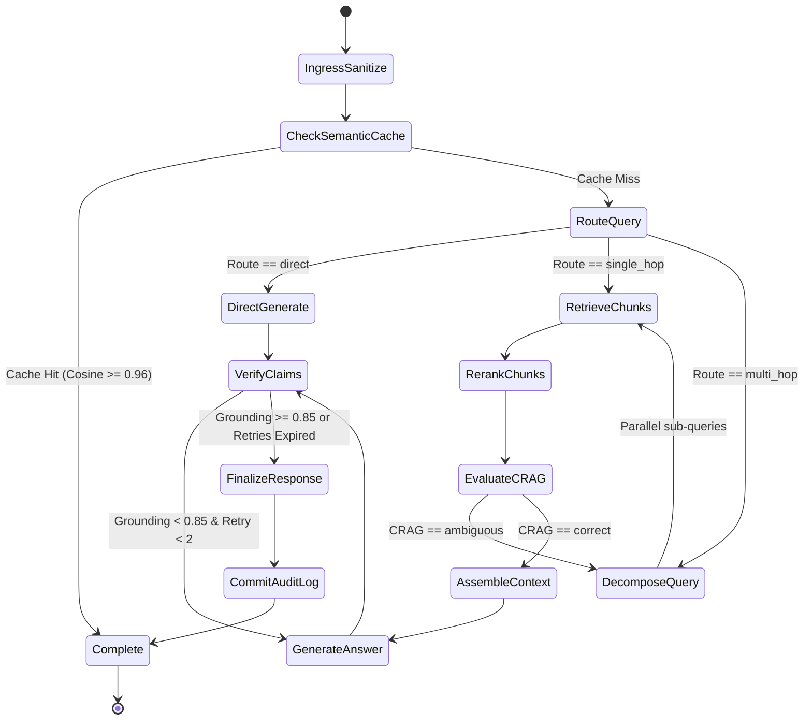

# Master Technical Architecture Specification
# Autonomous Enterprise-Grade Self-Optimizing RAG Platform

---

## 1. System Mission and Operational Overview

### 1.1 Purpose of the Platform
This platform is a production-grade, autonomous document intelligence and question-answering system. It transitions beyond naive Retrieval-Augmented Generation (RAG) by introducing:
1. Zero-trust security controls with active indirect prompt injection defense and vector-level role-based access control (RBAC).
2. Economic inference management featuring an in-memory semantic query cache and an adaptive multi-tier complexity router.
3. High-fidelity document ingestion with layout-aware table extraction and contextual chunk enrichment.
4. Corrective RAG (CRAG) quality gating to eliminate irrelevant or ambiguous retrieved context prior to generation.
5. Atomic claim-level Natural Language Inference (NLI) verification for sentence-level citation attribution.
6. A closed-loop evolutionary self-improvement engine that clusters failures and autonomously tunes parameters against an automated golden regression benchmark.

### 1.2 Target Personas and Deployment Context
* B2B enterprise document analysis (contracts, technical specifications, balance sheets, compliance policies).
* Strict multi-tenant operational environments with compartmentalized data access.
* Environments requiring deterministic latency SLAs and predictable cloud inference budgets.

---

## 2. High-Level System Architecture and C4 Container Blueprint



---

## 3. Subsystem 1: Document Ingestion and Contextual Enrichment Pipeline

### 3.1 Overview
Enterprise documents contain complex layout structures (tables, headers, footnotes) that traditional character-slicing destroys. The ingestion pipeline extracts layout metadata and prepends global context summaries to every chunk before generating embeddings.

### 3.2 Ingestion Flowchart



### 3.3 Contextual Chunking Formulation
For any given raw chunk $C_i$ from document $D$, the enriched chunk representation $C_i^*$ passed to the embedding model is:
$$C_i^* = \text{"[Document: "} || \text{Metadata}(D).\text{title} || \text{", Section: "} || \text{Metadata}(C_i).\text{section} || \text{", Context: "} || \text{Summary}(D) || \text{"]\n\n"} || C_i$$
This ensures isolated vector coordinates retain global semantic orientation.

---

## 4. Subsystem 2: Cost-Controlled Routing and Semantic Cache Engine

### 4.1 Overview
Every incoming query is checked against an in-memory vector cache to eliminate redundant model calls. If a cache miss occurs, the query's complexity is dynamically classified to ensure compute is only expended when required.

### 4.2 Query Processing Flowchart



### 4.3 Semantic Cache Cosine Decision Boundary
Given an input query vector $\vec{q}$ and cached query vector $\vec{c}$:
$$\cos(\vec{q}, \vec{c}) = \frac{\sum_{j=1}^{d} q_j c_j}{\sqrt{\sum_{j=1}^{d} q_j^2} \sqrt{\sum_{j=1}^{d} c_j^2}}$$
$$\text{Action} = \begin{cases} 
\text{Serve from cache}, & \text{if } \cos(\vec{q}, \vec{c}) \ge 0.960 \\ 
\text{Dispatch to routing pipeline}, & \text{otherwise}
\end{cases}$$

---

## 5. Subsystem 3: Corrective Hybrid Retrieval (CRAG) and Reranking

### 5.1 Overview
The retrieval subsystem merges dense vector similarity with sparse BM25 lexical match via Reciprocal Rank Fusion (RRF), scores candidates with a cross-encoder, and subjects results to a Corrective RAG (CRAG) confidence evaluator.

### 5.2 Retrieval and CRAG Flowchart



---

## 6. Subsystem 4: Atomic Claim-Level NLI Verification Engine

### 6.1 Overview
To guarantee strict hallucination elimination, generated responses are not assessed as unparsed blobs. Instead, the response is factored into atomic propositional statements, and each statement is independently verified against the retrieved context using Natural Language Inference (NLI).

### 6.2 Verification Flowchart



### 6.3 Grounding Mathematical Formula
Given extracted claims $C = \{c_1, c_2, \dots, c_P\}$:
$$\text{GroundingScore} = \frac{\sum_{i=1}^{P} \mathbb{I}\left(\text{NLI}(c_i, \text{Context}) == \text{ENTAILED}\right)}{P}$$
where:
* $\mathbb{I}$ is the indicator function.
* An answer is flagged as ungrounded if $\text{GroundingScore} < 0.85$.

---

## 7. Subsystem 5: Autonomous Evolutionary Optimization Engine

### 7.1 Overview
When users provide downvotes or when the NLI verification engine flags hallucinations, the incident is logged in the transactional database. Periodically, the evolutionary engine analyzes these failures, proposes adjustments, and tests them against a golden benchmark before updating production configurations.

### 7.2 Optimization Flowchart



---

## 8. LangGraph State Machine Specification

### 8.1 State Schema
```python
from typing import TypedDict, List, Dict, Any, Optional

class EnterpriseRAGState(TypedDict):
    # Ingress & Security
    raw_query: str
    sanitized_query: str
    session_id: str
    tenant_id: str
    user_roles: List[str]
    security_flags: Dict[str, Any]

    # Economics & Routing
    execution_route: str          # "direct" | "single_hop" | "multi_hop"
    token_budget_allocated: int
    cache_hit: bool

    # Retrieval & Evidence
    sub_queries: List[str]
    retrieved_chunks: List[Dict[str, Any]]
    reranked_chunks: List[Dict[str, Any]]
    crag_verdict: str             # "correct" | "ambiguous" | "incorrect"
    structured_context: str

    # Answer Generation & Verification
    raw_generation: str
    atomic_claims: List[Dict[str, Any]]
    verified_answer: str
    grounding_score: float
    citations: List[Dict[str, Any]]
    retry_count: int

    # Observability & Cost Telemetry
    prompt_tokens: int
    completion_tokens: int
    estimated_cost_usd: float
    stage_latencies_ms: Dict[str, float]
    total_latency_ms: float
```

### 8.2 State Transition Diagram



---

## 9. Complete Storage and Relational Schema

### 9.1 Relational Storage Schema (SQLite WAL Mode)
```sql
PRAGMA journal_mode=WAL;
PRAGMA synchronous=NORMAL;

-- Sessions Table
CREATE TABLE IF NOT EXISTS sessions (
    session_id TEXT PRIMARY KEY,
    tenant_id TEXT NOT NULL,
    created_at TIMESTAMP DEFAULT CURRENT_TIMESTAMP,
    last_active TIMESTAMP DEFAULT CURRENT_TIMESTAMP
);

-- Granular Feedback and Verification Audit Log
CREATE TABLE IF NOT EXISTS feedback_ledger (
    id TEXT PRIMARY KEY,
    session_id TEXT NOT NULL,
    created_at TIMESTAMP DEFAULT CURRENT_TIMESTAMP,
    query_text TEXT NOT NULL,
    rewritten_query TEXT,
    generated_answer TEXT NOT NULL,
    grounding_score REAL NOT NULL,
    is_correct BOOLEAN NOT NULL,
    failure_category TEXT,
    latency_ms REAL NOT NULL,
    token_count INTEGER NOT NULL,
    cost_usd REAL NOT NULL,
    context_chunks_json TEXT NOT NULL,
    FOREIGN KEY(session_id) REFERENCES sessions(session_id)
);
CREATE INDEX IF NOT EXISTS idx_feedback_correct ON feedback_ledger(is_correct);
CREATE INDEX IF NOT EXISTS idx_feedback_tenant ON feedback_ledger(session_id);

-- System Hyperparameter and Prompt Versions
CREATE TABLE IF NOT EXISTS parameter_versions (
    version_id TEXT PRIMARY KEY,
    created_at TIMESTAMP DEFAULT CURRENT_TIMESTAMP,
    system_prompt TEXT NOT NULL,
    rrf_k_constant INTEGER NOT NULL,
    rerank_threshold REAL NOT NULL,
    faithfulness_score REAL,
    context_recall_score REAL,
    is_active BOOLEAN DEFAULT 0
);

-- Security Incident Log
CREATE TABLE IF NOT EXISTS security_audit_log (
    incident_id TEXT PRIMARY KEY,
    created_at TIMESTAMP DEFAULT CURRENT_TIMESTAMP,
    tenant_id TEXT,
    incident_type TEXT NOT NULL,
    offending_payload TEXT NOT NULL,
    action_taken TEXT NOT NULL
);
```

### 9.2 Vector Metadata Contract (ChromaDB / Qdrant)
Every stored chunk contains the following metadata structure:
```json
{
  "chunk_id": "doc_a98f12_p3_c2",
  "document_id": "doc_a98f12",
  "source": "Financial_Report_Q3.pdf",
  "tenant_id": "tenant_enterprise_01",
  "access_roles": ["finance", "auditor"],
  "page": 3,
  "chunk_index": 2,
  "section_heading": "Consolidated Operating Expenses",
  "document_summary": "Financial report covering Q3 fiscal performance and expenditures.",
  "created_at": 1730761200
}
```

---

## 10. Repository Directory Structure

```
self-improving-agentic-rag/
├── docs/
│   ├── ARCHITECTURE.md            # This master architecture specification
│   ├── IMPLEMENTATION_STEPS.md    # Step-by-step phased execution guide
│   ├── PROJECT_STATUS.md          # Component readiness & benchmark scorecard
│   ├── SECURITY_SPEC.md           # Security threat model & RBAC specification
│   ├── EVALUATION_FRAMEWORK.md    # RAG Triad benchmarks & regression protocol
│   ├── COST_AND_INFERENCE_SPEC.md # Semantic cache & token economics specification
│   └── README.md                  # Master documentation index
├── backend/
│   ├── __init__.py
│   ├── main.py                    # FastAPI non-blocking application entrypoint
│   ├── config.py                  # Pydantic environment configuration
│   ├── orchestrator.py            # LangGraph asynchronous state machine
│   ├── security/
│   │   ├── __init__.py
│   │   ├── injection_shield.py    # Indirect prompt injection detection
│   │   ├── pii_scrubber.py        # PII and secret redaction engine
│   │   └── tenant_manager.py      # Tenant ACL and metadata query mask
│   ├── routing/
│   │   ├── __init__.py
│   │   ├── semantic_cache.py      # In-memory vector cache (<40ms hits)
│   │   ├── budget_controller.py   # Token and latency budget manager
│   │   └── adaptive_router.py     # Intent & query complexity classifier
│   ├── ingestion/
│   │   ├── __init__.py
│   │   ├── document_loader.py     # Layout-aware document parser
│   │   ├── text_splitter.py       # Contextual chunk enricher
│   │   └── cached_bm25.py         # Persistent incremental BM25 index
│   ├── agents/
│   │   ├── __init__.py
│   │   ├── retriever.py           # Hybrid dense + sparse RRF retriever
│   │   ├── reranker.py            # Cross-encoder MS-MARCO reranker
│   │   ├── crag_evaluator.py      # Corrective RAG quality gate
│   │   ├── planner.py             # Multi-hop query decomposition agent
│   │   └── answer_generator.py    # Grounded answer generation agent
│   ├── verification/
│   │   ├── __init__.py
│   │   ├── claim_extractor.py     # Atomic propositional claim decomposer
│   │   ├── entailment_verifier.py # Natural Language Inference verifier
│   │   └── citation_mapper.py     # Token-span citation and redactor
│   ├── evolution/
│   │   ├── __init__.py
│   │   ├── failure_clusterer.py   # Unsupervised failure pattern clustering
│   │   ├── parameter_tuner.py     # Prompt & hyperparameter optimizer
│   │   └── eval_harness.py        # Automated golden regression benchmark
│   ├── storage/
│   │   ├── __init__.py
│   │   └── db.py                  # Async SQLite connection pool with WAL
│   └── api/
│       ├── __init__.py
│       ├── chat.py                # Streaming SSE chat endpoints
│       └── upload.py              # Asynchronous document ingestion endpoints
├── frontend/
│   ├── package.json
│   ├── tailwind.config.js
│   └── src/
│       ├── App.js                 # Primary chat interface
│       ├── components/
│       │   ├── ChatMessage.js     # Markdown & syntax rendered message bubble
│       │   ├── PipelineTimeline.js# Live glassbox pipeline execution visualizer
│       │   ├── MetricsDashboard.js# Live cost, latency, & evaluation charts
│       │   └── Sidebar.js         # Document management & status sidebar
├── evaluation/
│   ├── golden_dataset.json        # 50 curated ground-truth QA benchmark pairs
│   └── rag_evaluator.py           # Standalone evaluation execution CLI
├── tests/
│   ├── unit/                      # Unit tests for security, routing, retrieval
│   └── integration/               # End-to-end pipeline execution tests
├── Dockerfile
├── docker-compose.yml
├── requirements.txt
└── README.md
```

---

## 11. Production Service Level Agreements (SLAs)

| Metric | Target SLA | Method of Verification |
|---|---|---|
| **Semantic Cache Hit Latency** | $\le 40\text{ ms}$ | Benchmarked at API ingress boundary |
| **Uncached Pipeline Latency (P95)** | $\le 1900\text{ ms}$ | Full hybrid search, rerank, and generation |
| **Grounding Faithfulness Score** | $\ge 0.94$ | Evaluated against Golden Benchmark |
| **Context Recall Score** | $\ge 0.90$ | Evaluated against Golden Benchmark |
| **System Availability** | $99.9\%$ uptime | Monitored via health probe and container restarts |
| **Inference Cost Reduction** | $\ge 65\%$ reduction | Derived from cache hits and model tiering |
