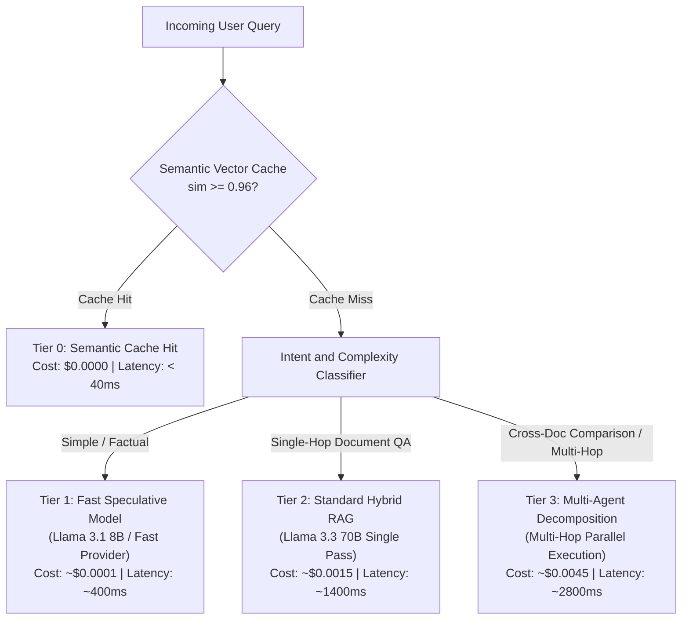

# Cost Economics and Inference SLA Specification
## Inference Optimization, Semantic Caching and Token Budget Allocation

---

## 1. The Inference Cost Dilemma in Enterprise RAG

In enterprise deployments, naive RAG pipelines suffer from unsustainable unit economics:
* A single query with a 5-turn history and 5 retrieved chunks ($3,000$ tokens input, $500$ tokens output) on proprietary frontier models costs between approximately $\$0.015 \text{ and } \$0.04$ per request.
* At $50,000$ queries per day, annual inference spend reaches $\$270,000 - \$730,000$ with $p_{95}$ latencies exceeding $4.5$ seconds.
* Target: Reduce average cost per query by >= 65% while cutting $p_{95}$ latency to under $1.9$ seconds without sacrificing answer accuracy.

---

## 2. Multi-Tier Model Cascading and Economic Routing



---

## 3. Semantic Query Cache Architecture (`backend/routing/semantic_cache.py`)

### 3.1 Mathematical Principle
A query $q_{\text{new}}$ is considered identical to a previously validated query $q_{\text{cached}}$ if the cosine similarity of their embedding vectors satisfies:
$$\text{Sim}(q_{\text{new}}, q_{\text{cached}}) = \frac{\vec{e}(q_{\text{new}}) \cdot \vec{e}(q_{\text{cached}})}{\|\vec{e}(q_{\text{new}})\| \|\vec{e}(q_{\text{cached}})\|} \ge 0.96$$

### 3.2 Storage and Search Layer
* Storage Engine: In-memory DuckDB table or lightweight Annoy/HNSW vector index.
* Payload Structure:
  ```json
  {
    "cache_key": "sha256_hash",
    "query_text": "What is the severance package policy?",
    "vector": [0.021, -0.043, ...],
    "response_answer": "According to Section 6.1...",
    "citations": [...],
    "grounding_score": 0.98,
    "created_at": 1730761200,
    "ttl_seconds": 86400
  }
  ```
* Invalidation Trigger: Whenever a document is uploaded, updated, or deleted via `/api/upload` or `/api/documents/{source}`, the cache partition associated with that document's namespace is invalidated automatically.

---

## 4. Token and Budget Allocation Ledger (`backend/routing/budget_controller.py`)

Each session is bound to strict token ceilings and latency budgets:

| Parameter | Default Constraint | Hard Limit / Abort Threshold |
|---|---|---|
| **Max Context Chunks Passed to LLM** | 3 chunks (~1,200 tokens) | 6 chunks (~2,400 tokens) |
| **Max Retries on Hallucination** | 1 retry | 2 retries |
| **Session Daily Token Limit** | 50,000 tokens | 100,000 tokens |
| **P99 Execution Timeout** | 5,000 ms | 8,000 ms (Graceful partial return) |

### 4.1 Cost Telemetry Equation
Telemetry is calculated per request and appended to the response trace:
$$\text{Cost}_{\text{query}} = (\text{Tokens}_{\text{prompt}} \times \text{Rate}_{\text{input}}) + (\text{Tokens}_{\text{completion}} \times \text{Rate}_{\text{output}})$$
Tracked dynamically and surfaced directly in the frontend glassbox inspector.
