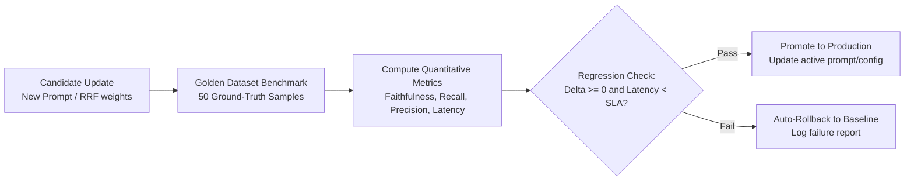

# Evaluation and Benchmarking Framework
## Continuous Metric Tracking, Golden Datasets and Automated Regression Gating

---

## 1. Overview and Evaluation Philosophy

A self-improving RAG system is only as credible as its verification methodology. In production, changes to prompts, chunking parameters, or retrieval weights cannot be deployed based on intuition. 

This framework establishes an automated, quantitative evaluation harness using the RAG Triad and Propositional Claim Entailment. It serves as an automated quality gate in the development loop and the CI/CD pipeline.



---

## 2. Evaluation Metric Definitions

### 2.1 Faithfulness (Grounding Accuracy)
Measures whether every claim in the generated answer can be mathematically inferred from the retrieved context.
$$\text{Faithfulness} = \frac{|\text{Number of Claims Entailed by Context}|}{|\text{Total Claims in Answer}|}$$
* Target: >= 0.94 (Baseline: 0.68)
* Failure Condition: Any claim contradicted or unsupported by context triggers a penalty.

### 2.2 Answer Relevance
Measures how directly the generated answer addresses the user's original query, penalizing redundant or evasive answers.
$$\text{Answer Relevance} = \frac{1}{N} \sum_{i=1}^N \cos(\vec{E}_{\text{query}}, \vec{E}_{\text{gen\_question}_i})$$
* Target: >= 0.92 (Baseline: 0.72)

### 2.3 Context Precision (Signal-to-Noise Ratio)
Measures whether the top-ranked retrieved chunks contain the actual ground-truth evidence, penalizing irrelevant chunks that rank higher than relevant ones.
$$\text{Context Precision@K} = \frac{\sum_{k=1}^K (\text{Precision@}k \times v_k)}{\text{Total Relevant Chunks in Top } K}$$
* Target: >= 0.88 (Baseline: 0.61)

### 2.4 Context Recall (Completeness of Evidence)
Measures whether all necessary pieces of evidence from the ground-truth answer were retrieved in the context chunks.
$$\text{Context Recall} = \frac{|\text{Ground-Truth Sentences Attributable to Context}|}{|\text{Total Sentences in Ground-Truth}|}$$
* Target: >= 0.90 (Baseline: 0.65)

### 2.5 Inference Economics and Latency
* Average Latency (Non-cached): < 1900 ms
* P99 Latency: < 4000 ms
* Average Token Consumption: <= 1200 tokens/query

---

## 3. Golden Evaluation Dataset Specification (`evaluation/golden_dataset.json`)

The test suite requires a minimum of 50 curated question-context-ground_truth triples categorised by complexity:

```json
[
  {
    "id": "eval_001",
    "category": "factual_single_hop",
    "question": "What is the maximum single-claim liability coverage in Policy Document A?",
    "ground_truth_context": ["Section 4.2 states that single-claim liability is capped at $5,000,000 USD."],
    "ground_truth_answer": "The maximum single-claim liability coverage under Policy Document A is $5,000,000 USD.",
    "acceptable_source": "Policy_Doc_A.pdf"
  },
  {
    "id": "eval_002",
    "category": "multi_hop_comparison",
    "question": "How did Q3 operational expenditures compare to Q2 across both software licenses and cloud compute?",
    "ground_truth_context": [
      "Q2 software licenses totaled $1.2M and cloud compute was $3.4M.",
      "Q3 software licenses increased to $1.5M while cloud compute decreased to $3.1M."
    ],
    "ground_truth_answer": "Software licenses rose by $300k (from $1.2M in Q2 to $1.5M in Q3), whereas cloud compute declined by $300k (from $3.4M in Q2 to $3.1M in Q3).",
    "acceptable_source": "Financial_Report_Q2_Q3.pdf"
  },
  {
    "id": "eval_003",
    "category": "negative_refusal",
    "question": "What is the company's policy on personal drone operation in the parking lot?",
    "ground_truth_context": [],
    "ground_truth_answer": "The provided documents do not contain information regarding personal drone operation in the parking lot.",
    "acceptable_source": null
  }
]
```

---

## 4. Automated Regression Gate Protocol

When the self-improvement engine (`backend/evolution/parameter_tuner.py`) generates a candidate configuration:

1. **Trigger Benchmark:** Run the 50-sample suite in parallel using `evaluation/rag_evaluator.py`.
2. **Compute Metric Delta:**
   $$\Delta \text{Faithfulness} = \text{Score}_{\text{candidate}} - \text{Score}_{\text{baseline}}$$
   $$\Delta \text{Recall} = \text{Score}_{\text{candidate}} - \text{Score}_{\text{baseline}}$$
   $$\Delta \text{Latency} = \text{Latency}_{\text{candidate}} - \text{Latency}_{\text{baseline}}$$
3. **Promotion Condition:**
   * $\Delta \text{Faithfulness} \ge 0.0$ AND
   * $\Delta \text{Recall} \ge 0.0$ AND
   * $\text{Candidate Latency} \le \text{SLA Threshold (2500ms)}$
4. **Action on Pass:**
   * Atomically write new active parameters to `optimizer_state.json`.
   * Log promotion event with commit hash and metric scorecard in `eval_runs` database table.
5. **Action on Failure:**
   * Discard candidate.
   * Write failure diagnostics to evaluation reports.
   * System continues operating with zero downtime on verified baseline.
