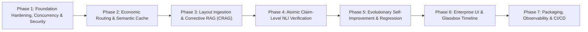

# Phased Implementation Guide and Engineering Execution Blueprint
## Self-Improving Agentic RAG Platform

---

## 1. Master Implementation Sequence

The platform is developed in seven strictly ordered phases. Each phase establishes clean technical boundaries and verified exit criteria before moving to the next.



---

## 2. Phase 1: Foundation Hardening, Concurrency and Security Core

### Step 1.1: Asynchronous Event Loop Refactoring and Threadpool Offloading
* **Files:** `backend/orchestrator.py`, `backend/agents/retriever.py`, `backend/agents/reranker.py`
* **Objective:** Prevent heavy PyTorch/SentenceTransformers and Cross-Encoder model inference from blocking the FastAPI async event loop.
* **Technical Specification:**
  ```python
  import asyncio
  from concurrent.futures import ThreadPoolExecutor

  _thread_pool = ThreadPoolExecutor(max_workers=4)

  async def run_in_pool(func, *args, **kwargs):
      loop = asyncio.get_running_loop()
      return await loop.run_in_executor(_thread_pool, lambda: func(*args, **kwargs))
  ```
* **Exit Gate:** Server handles 20 concurrent requests without stalling or timing out on the `/health` endpoint.

### Step 1.2: Transactional SQLite WAL Storage Layer
* **Files:** `backend/storage/db.py`, `backend/storage/__init__.py`, `backend/improvement/feedback_collector.py`
* **Objective:** Replace race-condition-prone flat JSON feedback storage with an asynchronous, transactional SQLite connection pool running in Write-Ahead Logging mode.
* **Technical Specification:**
  * Configure `aiosqlite` with `PRAGMA journal_mode=WAL;` and `PRAGMA synchronous=NORMAL;`.
  * Implement tables: `sessions`, `feedback_ledger`, `parameter_versions`, `security_audit_log`.
* **Exit Gate:** 50 concurrent feedback insert operations complete without database locks or data loss.

### Step 1.3: Inline Security Shield (Indirect Injection & PII Redactor)
* **Files:** `backend/security/injection_shield.py`, `backend/security/pii_scrubber.py`, `backend/security/tenant_manager.py`
* **Objective:** Intercept and neutralize indirect prompt injections embedded in uploaded files and mask sensitive PII before persistence.
* **Technical Specification:**
  * Heuristic and regex scanning for jailbreak command delimiters: `ignore all previous instructions`, `system prompt override`, `you are now in developer mode`.
  * Deterministic regex redactors for SSNs, credit cards (Luhn pattern verified), API keys, and JWT bearer tokens.
* **Exit Gate:** Test document containing hidden injection commands is successfully sanitized and flagged in the security audit table.

---

## 3. Phase 2: Economic Routing and Semantic Query Cache

### Step 2.1: In-Memory Vectorized Semantic Cache
* **Files:** `backend/routing/semantic_cache.py`, `backend/routing/__init__.py`
* **Objective:** Cache verified question-answer pairs using dense embedding representations to deliver sub-40ms responses at zero LLM inference cost.
* **Technical Specification:**
  * Maintain an in-memory normalized vector array with associated response payloads.
  * Execute cosine similarity comparison: if $\cos(\vec{q}_{\text{new}}, \vec{q}_{\text{cached}}) \ge 0.960$, return payload immediately.
  * Add automatic cache invalidation hooks triggered on document uploads or removals.
* **Exit Gate:** Re-issuing semantically identical questions returns in $<40\text{ ms}$ with zero tokens charged.

### Step 2.2: Token and Latency Budget Manager
* **Files:** `backend/routing/budget_controller.py`
* **Objective:** Enforce dynamic token caps and execution time ceilings per session to avoid out-of-budget model invocations.
* **Exit Gate:** Excessively long or recursive queries are aborted gracefully with structured HTTP 429/504 responses.

### Step 2.3: Adaptive Intent and Complexity Classifier
* **Files:** `backend/routing/adaptive_router.py`
* **Objective:** Route queries dynamically:
  * Tier 1 (Direct Factual): Bypasses retrieval, answers from conversational context.
  * Tier 2 (Single-Hop RAG): Standard hybrid retrieval and reranking.
  * Tier 3 (Multi-Hop Complex): Dispatches to query decomposition agent.
* **Exit Gate:** 30 benchmark queries classified into appropriate tiers with $>90\%$ accuracy.

---

## 4. Phase 3: Layout-Aware Ingestion and Corrective RAG (CRAG)

### Step 4.1: Hierarchical Layout-Aware Document Loader
* **Files:** `backend/ingestion/document_loader.py`
* **Objective:** Parse PDF and DOCX files while preserving table rows/columns in clean Markdown format and extracting section headers.
* **Exit Gate:** Complex multi-column financial tables retain row-column alignment in chunk metadata.

### Step 4.2: Contextual Chunk Enrichment (Document Summaries)
* **Files:** `backend/ingestion/text_splitter.py`
* **Objective:** Synthesize a global 2-3 sentence document summary upon ingestion and prepend structural context to every chunk before embedding generation.
* **Exit Gate:** Chunks retain document and section context when queried in isolation.

### Step 4.3: Persistent Incremental BM25 Inverted Index
* **Files:** `backend/ingestion/cached_bm25.py`
* **Objective:** Eliminate the severe performance bug of recalculating BM25 on the entire corpus per query. Maintain disk-backed serialization and update incrementally.
* **Exit Gate:** BM25 scoring across a 10,000-chunk corpus executes in $<15\text{ ms}$.

### Step 4.4: Corrective RAG (CRAG) Quality Evaluator
* **Files:** `backend/agents/crag_evaluator.py`
* **Objective:** Score retrieved chunk relevance before synthesis. Filter out noise (`INCORRECT`), trigger query expansion for `AMBIGUOUS`, and assemble verified evidence for `CORRECT`.
* **Exit Gate:** Synthetic distractor chunks are stripped prior to generation context assembly.

---

## 5. Phase 4: Atomic Claim-Level NLI Verification Engine

### Step 5.1: Propositional Claim Decomposer
* **Files:** `backend/verification/claim_extractor.py`, `backend/verification/__init__.py`
* **Objective:** Deconstruct complex generated answers into atomic, self-contained factual claims.
* **Exit Gate:** Paragraph response broken down into verifiable discrete proposition strings.

### Step 5.2: Natural Language Inference (NLI) Entailment Evaluator
* **Files:** `backend/verification/entailment_verifier.py`
* **Objective:** Classify each claim against retrieved context into `ENTAILED`, `CONTRADICTED`, or `UNVERIFIABLE`, calculating an aggregate `GroundingScore`.
* **Exit Gate:** Hallucinated factual claims trigger a GroundingScore drop and initiate regeneration.

### Step 5.3: Token-Span Citation Attribution and Redactor
* **Files:** `backend/verification/citation_mapper.py`
* **Objective:** Attribute verified claims to exact document names, page numbers, and chunk references. Strip unverified claims.
* **Exit Gate:** Citations map directly to exact source text spans with verifiable accuracy.

---

## 6. Phase 5: Autonomous Evolutionary Optimization Engine

### Step 6.1: Unsupervised Failure Pattern Clustering
* **Files:** `backend/evolution/failure_clusterer.py`, `backend/evolution/__init__.py`
* **Objective:** Cluster negative user feedback and NLI verification failures using sentence embeddings to identify root-cause error categories.
* **Exit Gate:** Generates actionable cluster themes from accumulated negative records.

### Step 6.2: Automated Golden Benchmark Evaluation Harness
* **Files:** `backend/evolution/eval_harness.py`, `evaluation/golden_dataset.json`
* **Objective:** Create and execute a 50-sample golden evaluation benchmark measuring Faithfulness, Answer Relevance, and Context Recall.
* **Exit Gate:** Full benchmark test run produces quantitative metrics and delta comparisons.

### Step 6.3: Automated Regression Gate with Zero-Downtime Rollback
* **Files:** `backend/evolution/parameter_tuner.py`, `backend/evolution/regression_gate.py`
* **Objective:** Propose new prompt templates and retrieval weights. Validate against the golden benchmark; automatically commit improvements or trigger zero-downtime rollback if metrics regress.
* **Exit Gate:** Candidate configuration tested, committed, or rejected with full audit logging.

---

## 7. Phase 6: Enterprise UI and Interactive Pipeline Glassbox

### Step 7.1: Tailwind CSS Design System Migration
* **Files:** `frontend/tailwind.config.js`, `frontend/src/index.css`
* **Objective:** Replace 2,000+ lines of raw inline styles with a modern, responsive Tailwind design system supporting dark and light themes.
* **Exit Gate:** UI displays clean, modern typography and layout across all resolutions.

### Step 7.2: Real-Time Markdown and Syntax Rendering
* **Files:** `frontend/src/components/ChatMessage.js`
* **Objective:** Render Markdown tables, code blocks with syntax highlighting, and bullet structures directly within streaming response bubbles.
* **Exit Gate:** Financial balance sheets and code snippets render with clean styling.

### Step 7.3: Interactive Glassbox Pipeline Visualizer
* **Files:** `frontend/src/components/PipelineTimeline.js`
* **Objective:** Render a live, stage-by-stage visualizer showing the exact lifecycle of every query (Routing -> Cache -> Retrieval -> CRAG -> NLI -> Cost).
* **Exit Gate:** Users can inspect exact latencies, chunk scores, and verification stages per request.

### Step 7.4: Real-Time Metrics & Evaluation Dashboard
* **Files:** `frontend/src/components/MetricsDashboard.js`
* **Objective:** Display real-time charts for rolling latency, cumulative token cost in USD, and RAGAS evaluation scores.
* **Exit Gate:** Metrics dashboard updates live as queries are processed.

---

## 8. Phase 7: DevOps, Observability and CI/CD

### Step 8.1: Production Docker Packaging
* **Files:** `Dockerfile`, `docker-compose.yml`
* **Objective:** Build multi-stage production images for FastAPI and React, managed via a single `docker compose up --build` command.
* **Exit Gate:** Entire system boots and passes health checks in isolated containers.

### Step 8.2: OpenTelemetry Spans and Prometheus Telemetry
* **Files:** `backend/observability/tracing.py`, `backend/observability/metrics.py`
* **Objective:** Instrument all pipeline nodes with distributed tracing spans and expose Prometheus metrics at `/metrics`.
* **Exit Gate:** Metrics endpoint returns valid Prometheus data for active scrapes.

### Step 8.3: Automated GitHub Actions CI Pipeline
* **Files:** `.github/workflows/ci.yml`
* **Objective:** Run automated linting (`ruff`), type checks (`mypy`), and unit/integration tests (`pytest`) on every pull request.
* **Exit Gate:** CI workflow runs and passes cleanly on GitHub.
